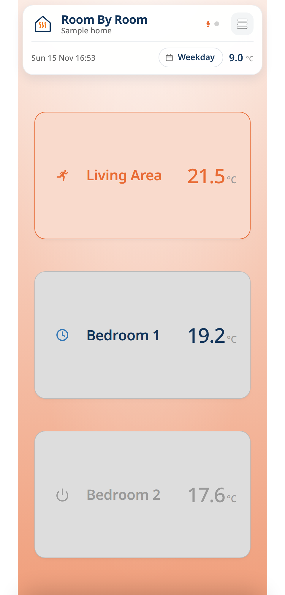
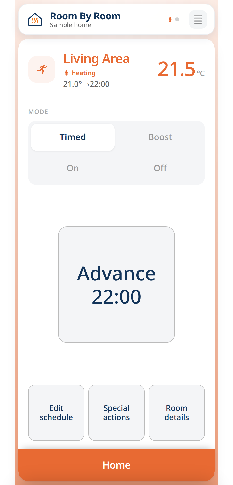
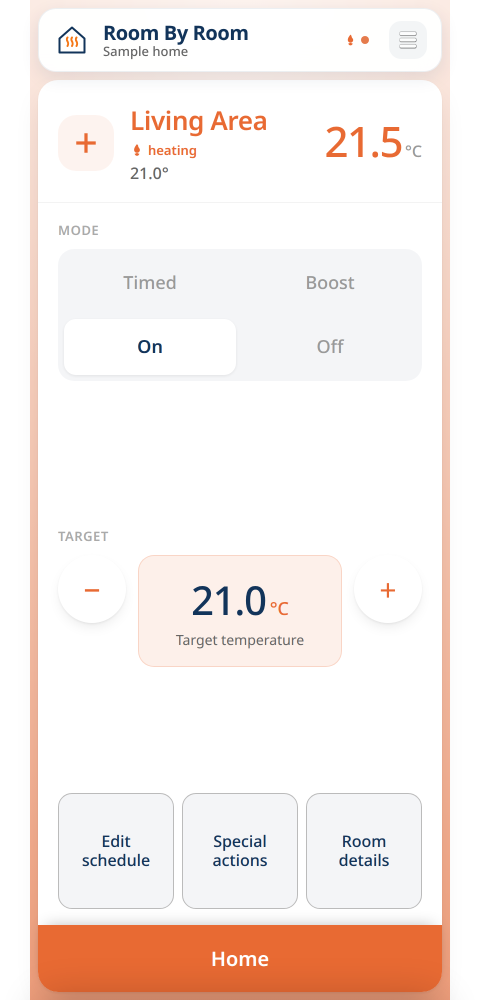
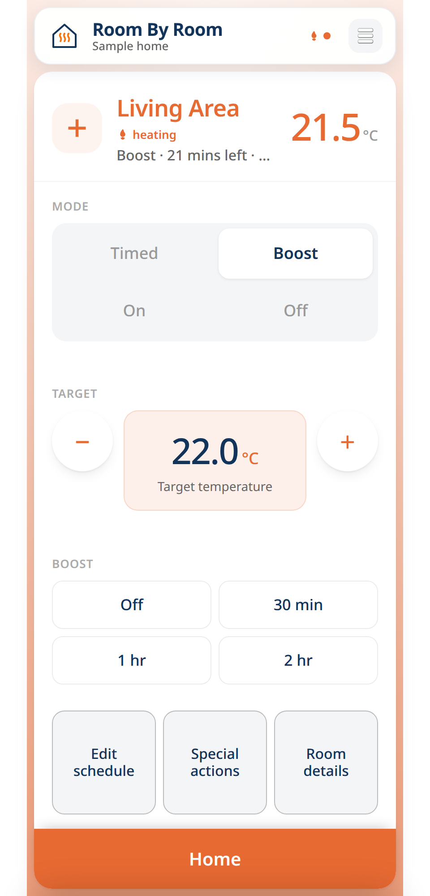
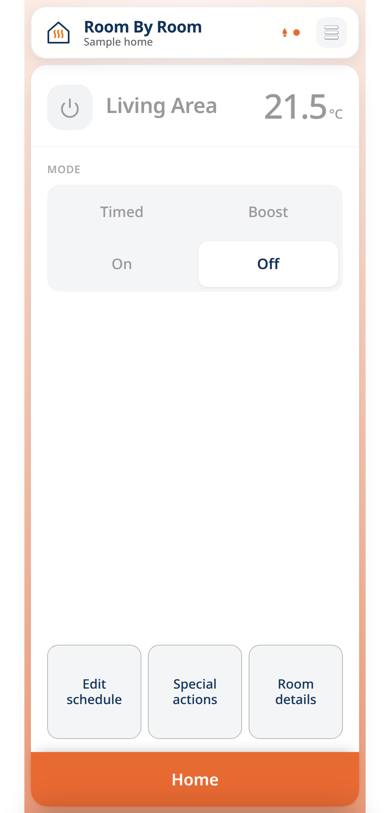
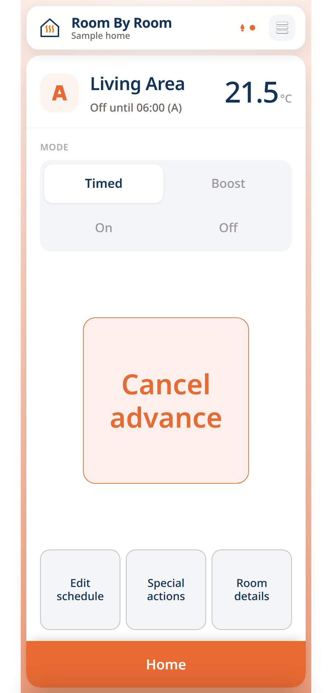
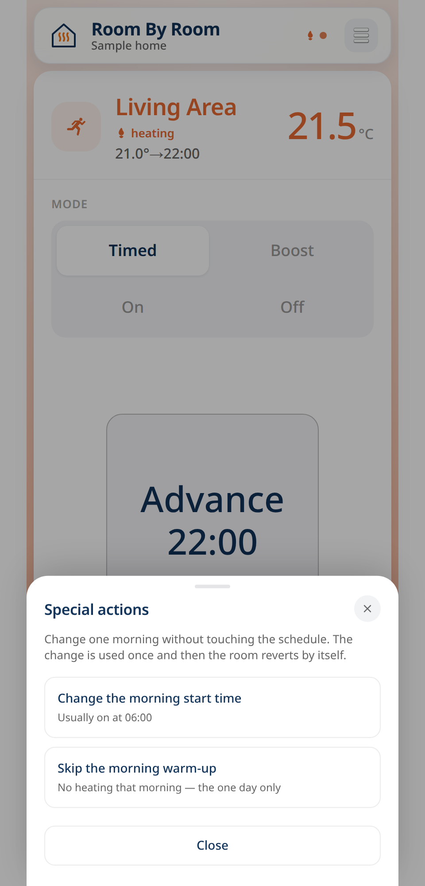
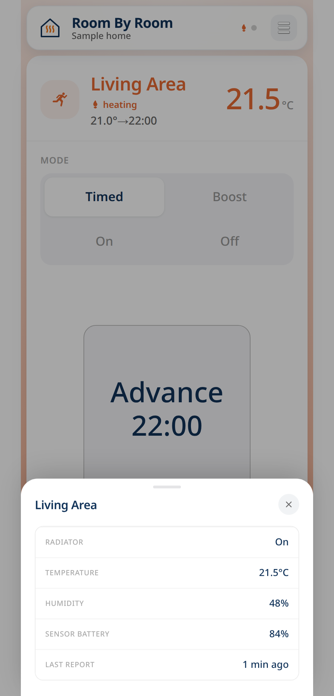
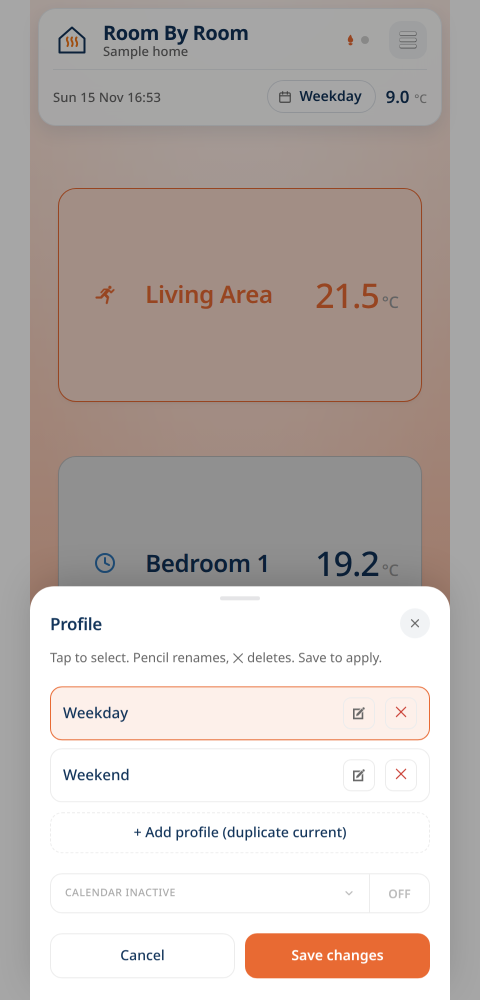

# The interface

> **Audience:** resident, property manager, housing provider · **Status:** draft · **Last verified:** 2026-11-15 · **See also:** [Glossary](../appendix/glossary.md) · [Preparing a unit](../preparation/05-preparing-a-unit.md) · [Modes, schedules and profiles](02-modes-schedules-profiles.md)

Room By Room is controlled from a web app on a phone or tablet. There is nothing to buy from an app store: the page at <https://rbrheating.com/heat/> is added to the home screen and opened like any other app. The same page can be used on more than one phone, and each phone is paired to the system once.

The screenshots on this page come from a demonstration installation with three rooms — **Living Area**, **Bedroom 1** and **Bedroom 2**. A real installation has the household's own room names, and its temperatures and times will differ. The page uses the **simplified view**, which is the default for a new installation and the easiest place to start; the detailed view shows the same rooms in a more compact form and is chosen under **Appearance** in the menu.

The app is a window onto the controller in the house, not the thing that runs the heating. The plan and the decisions stay at home, so the heating carries on when the phone is asleep, out of the house, or has no connection. What the app cannot do while it is disconnected is show fresh readings or send a new instruction; the top bar says **Reconnecting…** and catches up when the connection returns.

*The simplified home. The three room pills are the whole of the sample installation; the top bar carries the system, the time, the profile and the outside temperature.*

## What the home screen shows

The **top bar** identifies the system and tells you how the connection is doing. The house mark on the left opens the About sheet, which contains the Manual link and the Systems list. The system name sits beside it. The small dot pulses as replies arrive; the flame beside it appears while the system is asking the boiler for heat. The hamburger button on the right opens the menu.

The **second row** carries the date and time, the active **profile** (here, **Weekday**), and the **outside temperature** when an outside sensor is fitted. The profile is the set of schedules in use; tapping its pill opens the profile sheet. The snowflake badge appears beside the outside reading when frost protection is active.

The **room pills** are the rooms in this system, in the order they were arranged in **Rooms and Devices**. Each pill carries the room name, its current temperature and a small icon. The pill is a button: tap it to open that room.

The room pills grow to share the height of the screen, so a three-room installation fills the page with three large targets that are easy to hit with a thumb. The spaces between them let the chosen background colour show through; they are not a single solid list.

## Reading the colour and the icon

The colour and the icon answer two different questions: the colour says what the room is doing, and the icon says why. The same rules apply on the home pills and on the room page.

| What you see | What it means |
|---|---|
| Orange name and temperature, orange-edged pill | The room is **heating now**: its radiator or valve is on. The running figure on the left is the Timed icon for a room inside a scheduled period. |
| Blue name and temperature, blue-edged pill | The room is inside a scheduled **Timed** period but is not heating at this moment — usually because it has already reached its target. The schedule is still in charge. |
| Black name, neutral grey pill, clock icon | The room is **Timed but between periods**. Nothing is being asked for; the next scheduled change is shown on the room page. |
| Faint grey name, neutral grey pill, power icon | The room is **Off**: deliberately out of the heating plan. It still reports its temperature, but it will not be heated by the schedule. |
| Orange **+** icon | The room is **On**, or is being **Boosted** — a temporary heat that raises the room above its schedule. |
| Orange **A** icon | **Advance** is active on a Timed room: the next scheduled change has been brought forward. |
| Amber warning icon or amber warning row | Something needs attention: a thermometer has stopped reporting, a relay is not answering, or a relay has failed. The room page's **Room details** gives the reading behind it. |
| Battery outline above the temperature | The room's thermometer battery is low. The icon is stronger when the battery is nearly empty. |
| Flame beside the dot in the top bar | The boiler is being asked for heat, because at least one room is calling or frost protection is active. |

The colour is deliberately quiet when nothing is happening. A room between periods and a room that is Off both wear the same neutral pill; the difference is that the Off room's text is faint and its icon is a power symbol. That makes an unused spare room recede without turning it into the brightest thing on the screen.

## Opening a room

Tap any room pill to open that room's page. The page keeps the room's header — name, current temperature, heating or offline tag, and a subline describing the schedule — and adds the controls for that room. The **Home** button at the bottom returns to the room list.

*The room page for the Living Area. It is following its Timed schedule, so the Timed mode is lit, the next change is offered as Advance, and the schedule's target is in charge.*

The page has five parts, from top to bottom:

- the **mode grid** — **Timed**, **Boost**, **On**, **Off** — with the current mode lit;
- the **target temperature**, shown when the mode needs one (On or Boost), with minus and plus buttons;
- the **Advance** button, shown for a Timed room when there is a next change to bring forward;
- the **Boost** duration buttons, shown when Boost is being chosen or is already running;
- the three **actions** at the bottom — **Edit schedule**, **Special actions** and **Room details** — and the **Home** button.

The subline under the room name is the shortest description of what the room is doing. In a Timed period it shows the temperature the room is heading for and the time of the next change, such as `21.0°→22:00`. Between periods it says `Off until 18:00`. An active Advance adds `(A)`. An active boost says `Boost` and counts down.

## The four modes

A mode is chosen by tapping it in the grid. There is no Save button: the change is sent to the controller at once and the page updates as the controller confirms it. The mode grid always shows which mode is in force.

### Timed — follow the schedule

**Timed** is the normal mode for a room in use. The room follows the periods set for it in the active profile: at each period's start it heats towards that period's temperature, and at its end it stops. Between periods it waits for the next one.

Choose **Timed** to put the room back under its schedule. The target is not set here, because the schedule owns it; use **Edit schedule** to change the times or temperatures. The **Advance** button is the one-off shortcut for the current period and is described below.

### On — heat until told to stop

**On** heats the room to a target and holds it there, ignoring the schedule. The target controls appear beneath the mode grid. Use **−** and **+** to change it in half-degree steps; the new target is sent as you tap, so there is nothing else to save.

The system-wide **Maximum on duration** in **System** puts a limit on how long a room may stay On. When the limit is reached the room returns to the mode it was in before On, rather than staying On indefinitely. **Always On** removes the limit.

Choose **On** for a room you want warm now and for the next few hours without changing its schedule — an unexpected guest, or a room being used at a different time.

### Boost — a temporary lift

**Boost** raises the room to a higher target for a chosen period, then puts it back into whatever mode it was in before. It is the quick answer to “I'm cold now” without rewriting the schedule.

Tap **Boost** and the duration row appears: **Off**, **30 min**, **1 hr** and **2 hr**. Choose a duration; the boost starts immediately. Adjust the target with **−** and **+** if the default is not what you want. The row stays visible while a boost is running, so you can replace its duration or tap **Off** to cancel it. The room returns to its previous mode when the boost ends.

The room page's subline counts down the remaining time and names the boosted target. On a narrow phone the end of that line may be shortened with an ellipsis; the pill and the **+** icon still show that a boost is in force.

A boost can be started from any mode, including Off. It is a temporary overlay, not a fourth schedule.

### Off — take the room out of the plan

**Off** stops the room following its schedule and stops calling for heat. The room still reports its temperature, so you can see how cold it is getting, but it will not be heated by the plan. The faint grey pill and power icon are the reminder that this is deliberate.

Off is the right mode for a spare room, a room being decorated, or a room whose radiator is not to be used. The room's schedule is not deleted; choosing **Timed** again puts it back under the same periods.

## Advance

**Advance** is available on a **Timed** room. It brings the next scheduled change forward to now, so the room moves into the next part of its day without waiting for the clock.

The button names the change it would bring forward — `Advance 22:00` in the Timed screenshot. Press it and the schedule jumps: from an active period this usually means ending the period early, so the room stops heating and waits for the next scheduled start. The button changes to **Cancel advance**, the room's subline gains **(A)**, and the pill shows the **A** icon. Press **Cancel advance** to return to the normal schedule.

Advance is a one-off for the current day, not a mode. It does not edit the schedule, and it cancels itself when the change it brought forward would have happened anyway. From a period that is followed immediately by another period, the room joins the following period instead of stopping in between.

## Special actions and the other controls

The three buttons at the bottom of the room page are for the things that are not a mode.

### Special actions — change one morning

**Special actions** changes the next morning without touching the schedule. The change is used once and the room reverts by itself. It is the right tool for “we are leaving early tomorrow” or “the guest is arriving late tonight”, not for a permanent change.

- **Change the morning start time** opens a time picker prepopulated with the room's usual morning start. The chosen time is used for one morning; a time at or after the scheduled off time skips the warm-up instead.
- **Skip the morning warm-up** leaves the room unheated that morning. The schedule resumes the following day.
- **Cancel the override** appears only while a one-off change is armed. It removes that change and leaves the schedule alone.

The sheet says which day the change applies to, **Today** or **Tomorrow**, and repeats the override in the start-time subtitle while one is armed.

### Edit schedule — change the plan itself

**Edit schedule** opens the schedule editor for the room. It changes the periods, their start and stop times, and their temperatures — the permanent plan that **Timed** follows. It is the subject of the next page, not a one-off control; if you only want a change for one morning, use **Special actions** instead.

### Room details — the readings behind the card

**Room details** opens a read-only sheet with the room's current readings: whether the radiator is on, the temperature, humidity, the thermometer battery, and how long ago the last report arrived. It is the place to look when a room says **offline**, when a temperature looks wrong, or when you need the battery level before changing a sensor.

It changes nothing. Close it with the cross, or by tapping outside the sheet.

### The profile pill and the menu

The pill in the top bar shows the active **profile**. Tapping it opens the profile sheet, where profiles are named and the calendar assigns them to days. The profile controls which set of schedules every room follows, so it is the quickest way to put the whole house on a weekday, a weekend or a holiday pattern. The profile sheet is described with schedules and profiles on the next page.

The hamburger menu holds the system-wide controls: **Appearance** (simplified or detailed view, and the background colour), **Profiles & schedules**, **System** (the system name, heating type and maximum On duration), **Rooms and Devices**, **Outside thermometer**, **Backups**, and **Send journal now**. The same menu is where a manager reaches the detailed view and the device wiring; the resident's everyday controls are the ones on this page.

The house mark opens the About sheet. **Manual** opens this documentation in a new tab. **Systems** lists the installations this phone can manage: select one to switch to it, rename the label this phone uses, or remove it from this phone. Removing a system here does not delete the installation or its account on the server.

## When something looks wrong

The top bar is the first place to look. A **Reconnecting…** label means the phone cannot reach the controller; the heating keeps running on its last plan. A pulsing dot with a flame means the controller is answering and asking for heat. A flame that stays on with no room calling is worth investigating. An amber warning on a room pill is the controller reporting a device problem; open **Room details** for the reading, and see [Troubleshooting](04-troubleshooting.md) for what to try next.

The app is a view of the controller, so a room that looks wrong in the app is not necessarily a room that is cold. The controller's own plan and the last readings are what the system is acting on; the app is how you see and change them.
