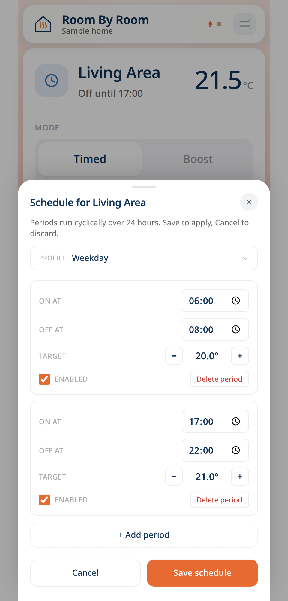
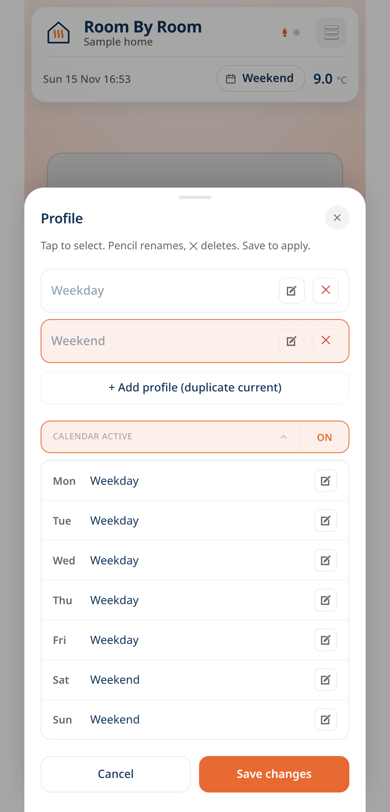

# Schedules and profiles

> **Audience:** resident, property manager, housing provider · **Status:** draft · **Last verified:** 2026-11-15 · **See also:** [The interface](01-the-interface.md) · [Glossary](../appendix/glossary.md)

The four modes — Timed, On, Boost and Off — and the everyday controls are described in [The interface](01-the-interface.md). This page is about the plan behind **Timed**: the periods inside a room's schedule, the profiles that hold those periods, and the calendar that decides which profile is in charge. Changing something here changes the plan until you change it again; Advance, Boost and Special actions are the one-off shortcuts for a single day.

## What a schedule is

A **schedule** is a room's set of periods: the times it should heat and the temperature it should reach. A **profile** is a complete set of those schedules, one per room. The active profile is the one the home screen is using, and the profile pill in the top bar names it.

The separation matters when the household's week changes shape. **Weekday** and **Weekend** can give the same room different times without duplicating the room list; a **Holiday** profile can put every room into a background setting; and a room can have its own variation — an office used late on weekdays, a guest room only at weekends.

A room's mode decides whether the schedule is used. **Timed** follows it. **On**, **Boost** and **Off** do not. If a room is On and the profile changes, the room stays On; the schedule it will return to when it is put back into Timed is the schedule in the profile that is active then.

## Opening the schedule editor

Open the room, then tap **Edit schedule** at the bottom of the room page. The schedule editor is a sheet over the room, titled with the room's name. It edits the schedule for **one room in one profile**; the profile pill at the top of the sheet says which. Tapping that pill lets you choose another profile, and the sheet then shows that profile's schedule for the same room.

The sheet in the screenshot has two periods. The first heats the Living Area to 20.0° from 06:00 to 08:00; the second heats it to 21.0° from 17:00 to 22:00. The room is in a gap when the schedule editor is opened, which is why the room behind the sheet says **Off until 17:00**.

## Reading a period

Each card is one period, and each has four controls:

- **On at** and **Off at** are the start and stop times. Each opens the device's own time picker — a dial on a phone, a time field on a computer — so any time can be set, to the minute.
- **Target** is the temperature the room is trying to reach during that period. Use **−** and **+** to change it in half-degree steps.
- **Enabled** switches the period into or out of the schedule without deleting it. An unticked period stays in the list, greyed out, and does not run.
- **Delete period** removes the period from the edit. Nothing is sent to the controller until **Save schedule**.

The times are a cycle over 24 hours, not a list with a first and a last. Periods are sorted by their start time when the schedule is saved. A gap between one period's stop and the next period's start is a period of no heating; a room in that gap is **Off until** the next start, exactly as [The interface](01-the-interface.md) describes.

A stop earlier than its start means the period runs overnight: 23:00 to 06:30 is one period that crosses midnight, not an error. An on time equal to its off time covers the whole 24 hours — useful for a room that should be held at one temperature all day.

## Adding and removing periods

**+ Add period** appends a new card. Its starting point depends on what is happening now: if a period is running, the new period starts where that one ends, because extending or replacing the current heat is the usual reason to add one. Otherwise it starts at the quarter-hour nearest the clock, rounded forward so it is never more than a few minutes behind.

A new period has no stop of its own yet, so its stop sits exactly one hour after its start until you choose one. Once a stop has been chosen, moving the start moves the stop by the same amount, preserving the duration you set. Both ends wrap around midnight.

**Delete period** removes the card from the edit; **Save schedule** is what makes the removal permanent. **Cancel** discards the whole editing session, including added, removed and changed periods.

## Saving the schedule

**Save schedule** applies the room's periods to the profile named in the sheet. The other profiles are untouched: a change made while the sheet says **Weekday** does not change **Weekend**. The room's mode is also untouched — a room that is On stays On after its Timed schedule is changed, and a room that is Off stays Off.

If the room is Timed, the new periods take effect from the controller's next decision. The room page's subline and the home pill update as the controller confirms the new plan.

## Profiles

The profile sheet is opened by tapping the profile pill in the top bar. It holds the profile list and the calendar.

Each row is one profile. Tap a row to make it the active profile — the home screen follows it immediately after **Save changes**. The pencil renames it; the cross deletes it; **+ Add profile (duplicate current)** creates a new profile by copying the active one, so a Weekday variant starts from the Weekday times rather than from nothing. **Save changes** applies every profile edit and selection as one request; **Cancel** discards the whole session.

A few rules protect the names the system relies on:

- **Two profiles cannot share a name.** The rename and the duplicate both refuse a name already in the list, because names are how rooms and calendar days refer to a profile.
- **Renaming moves the calendar with it.** Every day that named the old name is rewritten to the new one. A rename that left the days behind would silently fall back to the selected profile — the 2026-10-26 fault where Monday to Friday still named a profile that no longer existed and the next weekday morning ran **All Off**.
- **Deleting clears the days that named it.** The calendar does not keep a stale name; the affected days are emptied so the missing choice is visible.
- **Keep an active profile.** If the active profile is deleted, the sheet will not save until another row has been chosen; a set of profiles with nothing selected is not a valid plan.

## The calendar

The calendar decides which profile is in charge on each day of the week. With the calendar **OFF**, the profile selected in the list is the active profile on every day. With it **ON**, Monday to Sunday can each name a profile; the screenshot shows Monday to Friday on **Weekday** and Saturday and Sunday on **Weekend**. The profile pill in the home screen then shows the profile for today.

To turn the calendar on, tap the calendar header and set its switch to **ON**. Tap the header again to expand the seven day rows. Each day has a pencil: tap it, choose a profile from the picker, and the day row updates. **Save changes** applies the whole calendar and the profile list together; **Cancel** leaves the previous calendar in place.

With the calendar active, the profile rows are for editing and adding, not for choosing the active profile — the day grid owns that choice. The active row in the screenshot is **Weekend** because the sample date is a Sunday.

## Common patterns

- **A weekday and a weekend pattern.** Two profiles, each with the household's usual morning and evening periods; the calendar maps Monday to Friday and Saturday to Sunday.
- **A holiday or away pattern.** Duplicate the current profile, lower the targets and shorten the periods, and switch to it for the days away. The normal profile is still there when you return.
- **A room used at different times.** Give the room its own periods inside each profile rather than changing the whole house. The schedule editor is per room.
- **A room that should stay at one temperature.** A single 24-hour period (on equal to off) holds the target all day; use **On** if it should ignore the schedule and stay there until you stop it.
- **A room out of use.** Switch it to **Off**; its schedule remains in every profile and is ready when it comes back. Use a disabled period when only one block, rather than the whole room, should be suspended.

## What this page does not change

The schedule is the plan, not the day's exceptions. For a change that applies once and then disappears, use **Advance** (bring the next change forward), **Boost** (heat above the plan for a short time) or **Special actions** (change one morning's start or skip the warm-up). Those are described in [The interface](01-the-interface.md).

If a room is in the wrong mode, the schedule cannot help it: check that the room is **Timed** before assuming the plan is wrong. If the calendar shows a day's profile as **(missing)**, choose a profile for that day; the name no longer matches any profile in the list.
