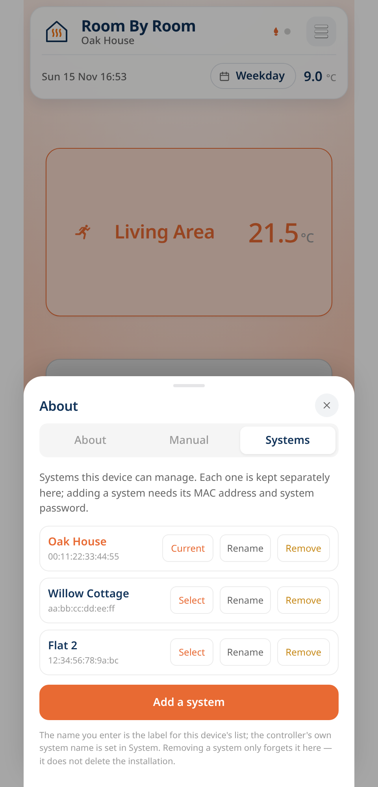

# Managing many systems

> **Audience:** installer, property manager, housing provider · **Status:** draft · **Last verified:** 2026-11-15 · **See also:** [The interface](01-the-interface.md) · [Schedules and profiles](02-modes-schedules-profiles.md) · [Glossary](../appendix/glossary.md)

A phone can hold more than one system. The **Systems** list in the About sheet is the address book: one entry for each installation this phone can reach, with one of them current. There is no primary system and no hierarchy — every entry is managed the same way, and switching is simply choosing which installation the app is looking at.

The everyday controls all act on the **current system** only. Changing a room's mode, editing a schedule, opening Backups or sending a journal affects the system named in the top bar, not every system in the list. That is the point of the list: one app, several installations, one decision about which is on screen.

## The Systems list

Open the About sheet with the house mark in the top bar, then choose the **Systems** tab. Each row shows the name this phone uses for the installation and the controller's MAC address. The row with the accent name is current; its button reads **Current** and is not a selection. Every other row offers **Select**, **Rename** and **Remove**.

The list is **local to this phone**. It is not a list held on the server, and it is not an account with members or roles. Adding an installation here does not create a server-side account, and removing it here does not delete one. The server's account register is `rbr-users.json`, one entry per MAC; it is provisioned separately by the installer or the web-host administrator.

## The current system

The current system is the one the app is connected to. The top bar carries the **controller's own system name**, which is edited under **System** in the menu. The name in the Systems list is a label for this phone's list and can be different: it is there so a person can tell Oak House from Willow Cottage, not to rename the controller.

When a system is current:

- every room pill, room page, schedule and profile belongs to that system;
- the profile name, outside reading and system name in the top bar belong to that system;
- a command sent from the app reaches that system's controller and no other.

Switching systems therefore reloads the app. The MQTT connection, the map and all of the sheet state are built for one system at a time; a reload is the clean way to hand the page from one installation to another. It is the same path the first pairing uses.

## Adding a system

Adding requires the same pair of values as first pairing: the controller's **MAC address** and its **system password**. The installation must already be provisioned in `rbr-users.json` on the web host — normally with `provision-system.py`, which also supplies the broker credentials the app needs. The Add flow creates the local entry for this phone; it does not create the server account.

1. Open **About → Systems** and tap **Add a system**.
2. Enter the name you want this phone's list to show — for example the site or household name.
3. Enter the controller's MAC address, printed on the device and stored in its `.mac_override`.
4. Enter the six-digit system password created when the system was provisioned.
5. The app exchanges the password for that system's token at `/verify`, stores the token with the new entry, selects the system and reloads on it.

The name asked for first is a local label, not the controller's system name. It is worth using the same name the estate uses in its own records, so the list and the paperwork agree.

If the add is refused, the MAC or password was not accepted. Check that the system was provisioned and that the password is the six-digit **system** password, not the MQTT password in the controller's `credentials` file. A system that pairs and then sits in demo mode has a different problem: the account exists but its broker `credentials` block is missing, which is also a provisioning fault.

## Selecting a system

Tap **Select** on any row that is not current. The app stores that MAC as the current one and reloads. The list comes back with the new row marked **Current**, and the home screen shows that system's rooms, profile and readings.

Selecting a system does not copy anything between installations. Schedules, rooms, devices and readings stay with their own system; the app is only changing which one it reads. A change made to Oak House is not made to Willow Cottage.

## Renaming a local entry

Tap **Rename** on a row to change the label in this phone's list. This changes only the local name. It does not change the controller's own **System → Name**, which is what the top bar shows once that system is current, and it does not reach the server or another phone.

The two names are deliberately separate. A manager may know an installation as "Flat 2" while the household has named it "Home"; the list label is for the manager's address book, and the controller's name is the household's own. Use **System → Name** when the household wants to change what the app calls the installation.

## Removing a system

**Remove** forgets a system on this phone. It does not decommission the installation, delete its `rbr-users.json` entry, or revoke its token. The system carries on running, and another phone that has it in its list is unaffected.

Removing the current system selects the first remaining entry and reloads. Removing the last entry clears the local identity and returns the app to demo mode, where it can be paired again.

Removal is the right action when a phone is handed on, when an engineer no longer needs a site, or when a system has been replaced. It is not a security revocation. If a phone has been lost, removing the entry from another phone does nothing to the lost phone's stored token; revocation is a server-side action, described below.

## Several phones

Each phone keeps its own list. There is no sync and no shared address book: the same three systems have to be added on each phone that needs them, with the same MAC and system password. Once added, each phone can select and manage any of them.

The system password is only used to obtain the token; it is not stored in the browser. The token is stored, one per system, and it is what lets that phone fetch the system's broker credentials without asking for the password again.

A system has one token, not one token per phone. Every phone that has added the system holds the same token. That is convenient, but it means the usual revocation is **all devices at once**: rotating the token in `rbr-users.json` (with `provision-system.py --rotate-token`) unpairs every phone that held it, including the manager's own. There is no per-phone token to withdraw on its own with the present account model.

## Security and revocation

- **Treat a paired phone as a key.** Anyone who can unlock the phone and open the app can manage every system in its list.
- **Remove systems before handing a phone on.** This clears this phone's list and its stored tokens, but see the next point.
- **To revoke access, rotate the system's token on the web host.** Removing the local entry does not revoke it. Rotating the token unpairs every device holding that system; each device then needs the system password again.
- **The system password is the secret to keep.** The MQTT password in `~/rbr/credentials` is a different secret and will not pair a phone.
- **The list is not an audit trail.** It shows what this phone knows, not who has accessed the system. The controller's own journal records the actions that reached it.

If a site is being decommissioned, the order is: remove it from the phones that hold it, rotate or delete its account on the web host, and deal with the controller and its data as the estate's process requires. Removing it from one phone is not enough.

## What the list is not

- **Not a combined dashboard.** It shows one system's home at a time; there is no estate-wide temperature or status view.
- **Not a server account.** There are no members, roles or invitations; the list is local and the account is the `rbr-users.json` entry.
- **Not a primary/secondary hierarchy.** Every system is a peer; the current one is simply the one on screen.
- **Not a revocation control.** Removing an entry forgets it here; the token and the installation remain until the server-side account is changed.

## A working checklist

For an estate or a small installer:

| Check | Why it matters |
|---|---|
| Every installation provisioned on the web host | The app's Add cannot create the server account or its broker credentials |
| The MAC and six-digit system password recorded for each site | They are the pair used to add it to each phone |
| A local name that matches the estate's records | The list is the address book; the controller's name is the household's |
| Each phone that needs access has each system added | There is no sync between phones |
| Handed-on phones cleared from the list, and lost-phone tokens rotated | Removal is local; rotation is what actually revokes access |
| A note of which token rotation affects every phone | One token per system, not one per device |
