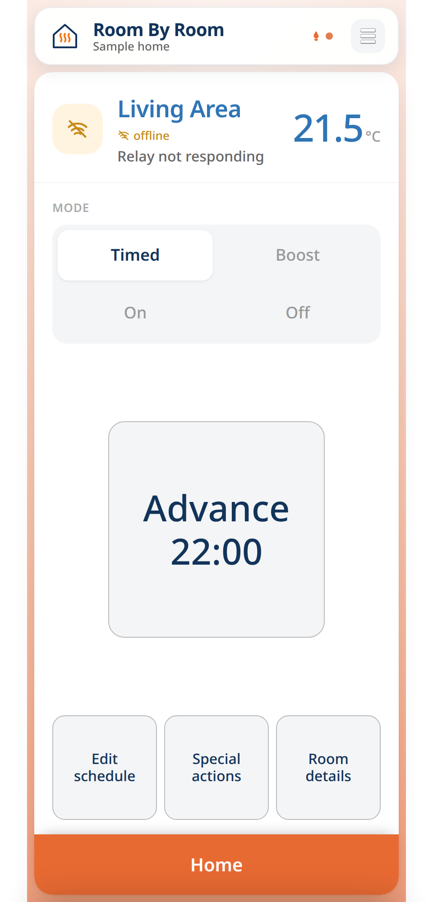
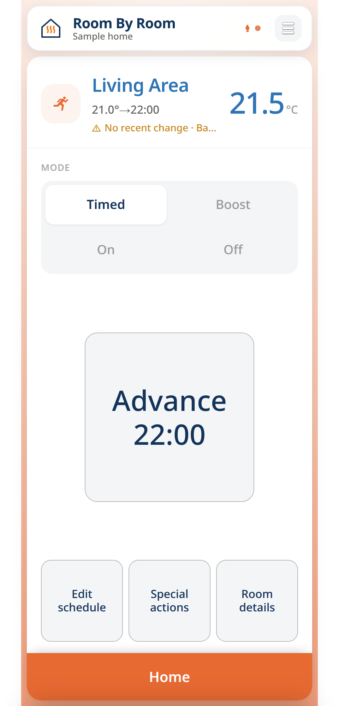

# Troubleshooting

> **Audience:** resident, property manager, housing provider · **Status:** draft · **Last verified:** 2026-11-19 · **See also:** [The interface](01-the-interface.md) · [Schedules and profiles](02-modes-schedules-profiles.md) · [Managing many systems](03-managing-many-systems.md) · [Glossary](../appendix/glossary.md)

Most problems with the app are not problems with the heating. The controller in the house carries on with its last plan when the phone cannot reach it, and a room that looks wrong on the screen can still be warm in the room. Troubleshooting therefore starts by separating three things: the phone's connection, the information the controller is reporting, and the heating hardware itself.

Nothing in this page asks you to open a boiler, a mains connection or a radiator valve. Gas and mains work belongs to a Gas Safe-registered heating engineer or a qualified electrician; water and valve work belongs to a plumber or heating engineer. The app is for seeing and changing the plan, not for repairing the system.

## First, read what the app is telling you

The top bar carries the connection and the system. The room card carries the room's state. The warning row and the offline tag are the two places a fault is named.



An **offline** tag is a device fault the controller has already detected. The subline names it: **Relay not responding**, **Valve not responding** or **Thermometer not reporting**. The room is not being heated while that remains true.



A **warning row** is softer than offline. **No recent change** means the last reading is old but the room is still being managed from it; **Radiator sensor in use** means the room's thermometer has gone quiet and the room is being heated from the radiator valve's own sensor, corrected by the difference RBR learned while both were reporting; **Battery low** means the thermometer needs attention. The row can hold more than one message, and on a narrow phone the end may be shortened with an ellipsis.

**Room details** on the room page is the reading behind the card: whether the radiator is on, the current temperature, humidity, battery and the age of the last report. Use it before deciding whether the problem is the sensor, the radiator or the plan.

## The first checks

| What you see | What to check first | What to do |
|---|---|---|
| **Reconnecting…** in the top bar | The phone's broadband or Wi-Fi, then the controller's power | The heating continues on its last plan. Wait for the app to recover, or reopen it once the network is back. If it stays on Reconnecting while other sites work, the controller or the connection to it needs the installer. |
| The demo home, with **Set up my system** | Whether this phone has a current system | This is not a fault. Open the house mark, choose **Systems**, and add or select the system. |
| The wrong system's rooms and name | The **Systems** list | Select the right system; the app reloads on it. The local label and the controller's own name can differ. |
| A room is **Offline** | The named device — relay, valve or thermometer | Note which one it names and call the installer if it does not clear. Do not open wiring or a boiler to investigate. |
| **No recent change** | The thermometer's battery and its distance from the controller | Replace the battery if it is low. If it persists, the sensor or its radio link needs the installer; the room is held off rather than heated blind. |
| **Radiator sensor in use** | The same thermometer fault | The room is still being heated, from the valve's own sensor and the corrected estimate shown in **Room details**. Treat it as the same fault as **No recent change**: replace the thermometer battery if it is low, and call the installer if it persists. |
| **Battery low** or a battery outline | The thermometer battery | Replace it. A reading at or below five per cent is the **Battery empty** artwork. |
| **No radiator assigned** | The room's wiring in **Rooms and Devices** | The room has no relay or valve the system can use. This is an installation or configuration fault; ask the installer. |
| A room stays cold in **Timed** | The subline and the current period | If it says **Off until** a time, the room is in a schedule gap and is behaving correctly. If it is inside a period, read the next section. |
| A room stays warm in **Off** | The valve or radiator control | A valve may be stuck open or set by hand. That is a valve/plumbing issue rather than an app setting; ask the installer. |
| A boost or **On** ends early | **System → Maximum on duration** | The cap returns the room to its previous mode when it is reached. **Always On** removes the cap. |
| The whole house is cold | Whether any room is calling, and the boiler | If the app connects and every room is Off or at target, the plan is doing what it says. If a room is calling and the boiler is not firing, the demand relay or the boiler needs the installer. |

## A room that will not heat

Work from the room outwards. The app can tell you which part is stopping it.

1. **Is the room in the right mode?** **On** and **Boost** heat to their target; **Timed** follows the schedule; **Off** does not heat. A room in **Timed** with a subline saying **Off until 18:00** is in a gap and is not faulty.
2. **Is the target above the current temperature?** On and Boost show the target. In Timed the target comes from the period; **Edit schedule** shows it. A room already at or above target is not expected to call for heat.
3. **Is the room offline?** An offline tag names the failed device. If it says **Relay not responding** or **Valve not responding**, the room will not heat until that device answers. If it says **Thermometer not reporting**, the controller has no reading to act on.
4. **Is the sensor stale?** **No recent change** means the controller is using the last reading. It holds the room off once the reading is too old, unless the room's radiator valve is reporting and can take over — then the card says **Radiator sensor in use** and the room keeps its plan on the corrected valve reading. A scheduled period that starts in that state begins from the last known value for its first half hour, then stops if no fresh reading arrives. That is deliberate: a room cools gently rather than being heated without feedback.
5. **Is the boiler being asked for heat?** The flame beside the dot in the top bar shows that the system is calling. If a room is calling but the boiler is not firing, the demand relay, its wiring or the boiler is the problem; call the installer.
6. **Is frost protection running?** The snowflake beside the outside reading means the system is protecting against frost. Some heating with every room apparently off can be expected in that state.

If steps 1 and 2 are right, the room reads online, the boiler is being asked for heat and the radiator is still cold, the problem is at the radiator, valve or boiler. That is a job for the installer or heating engineer.

## A room that will not stop

If a room is **Off** or at a low target and the radiator stays hot, the app has stopped asking for heat. The likely cause is a valve or radiator control that is stuck open or has been set by hand. A self-contained valve can also run its own local program; if it does, the valve is deciding rather than the app.

Do not force a valve or remove a radiator head to investigate. Note the room and ask the installer. If the room is uncomfortably hot and the household cannot wait, close the radiator's own valve if it has a manual control, and say what was done when the installer arrives.

## Sensor and battery warnings

A room's temperature is only as good as its last report. Many battery thermometers report on a roughly hourly heartbeat, or sooner when the temperature moves. A reading more than about three quarters of an hour old is treated as out of date, and one more than an hour old as failed; the room is held off until a fresh reading arrives, unless a self-contained radiator valve is supplying the feedback instead.

The exception is the start of a scheduled period: the first 30 minutes use the last known reading, because losing a morning warm-up to a reporting gap is worse than heating briefly on an old value. If the thermometer has still not reported when those 30 minutes are up, the heat goes off.

What helps:

- **Replace a low battery** as soon as the warning appears; a battery that is nearly empty is the usual cause of a sensor going quiet.
- **Check the room is not isolated** — a thermometer behind a metal case, in a cold porch or far from the controller can struggle to report.
- **Do not repeatedly remove and re-pair** a sensor unless the installer asks; re-pairing resets some of its reporting settings.
- **Tell the installer** if the same room keeps going quiet. Reporting intervals can be adjusted through the Zigbee software; the engineering note `doc/SENSOR-REPORTING.md` describes the commands, but this is an installer task.

## The schedule is not being followed

The schedule only applies to a room in **Timed**. Check these in order:

1. **The room's mode** — On, Boost and Off do not follow the schedule.
2. **The active profile** — the profile pill in the top bar names it. A profile change changes every room's Timed plan at once.
3. **The calendar** — if it is active, today's profile comes from the calendar, not from the last profile selected by hand. A day naming a profile that no longer exists shows **(missing)** in the profile sheet and falls back to the selected profile; choose a profile for that day.
4. **The date and time** — the controller works in local time. A machine whose clock or timezone is wrong follows the wrong part of the day.
5. **The period itself** — **Edit schedule** shows the times and the target. A gap between periods is an intentional **Off until** state, not a missed period.
6. **A one-off change** — **Advance** shows **(A)** on the room and **Cancel advance** on the room page; a **Special action** shows an override line. Either can change what happens for one day without changing the schedule.
7. **The maximum On duration** — a room in On mode returns to its previous mode when the cap is reached.

If the room is Timed, inside a period, with the right profile and a target above the temperature, and it is still not heating, go back to the hardware checks above.

## The app seems out of date

The app refreshes from the controller about every ten seconds. A room card can lag by a few seconds after a tap because the controller's confirmation is the next map. If the whole page looks stuck:

- check the top bar for **Reconnecting…**;
- close and reopen the app, or reload the page;
- make sure the phone is on a network that can reach the site;
- do not change the plan repeatedly while the connection is down; the controller keeps the last confirmed state and may apply the next command when it returns.

A map push that arrives while a sheet is open is held until the sheet closes, so a room card can look briefly behind while the profile, schedule or device sheet is up. Close the sheet and let the home refresh.

## Boiler, frost and whole-house behaviour

- **The boiler runs with every room at target.** The system asks for heat when any room calls, when frost protection is active, or while a boost or On room is below target. A short run after a room reaches target is normal.
- **The flame is on but no room looks cold.** Check **Room details** for the room that is calling; a stale reading or a valve that has not closed can keep the demand on.
- **The snowflake is showing.** Frost protection is active; the system is protecting the house rather than following the normal plan. That is expected in cold weather.
- **The whole house is cold and the app reconnects.** Check whether any room is calling. If none is, check the mode, profile and calendar. If one is, and the boiler is silent, call the heating engineer.

## Several systems

If the app is showing the wrong installation, open **About → Systems** and select the right row. The list is local to the phone; adding a system there does not provision it on the server, and removing it does not revoke access. For the difference between the local list, the current system and server-side revocation, see [Managing many systems](03-managing-many-systems.md).

A system that will not add at all is usually not provisioned, or the password is not the six-digit **system** password. Check the provisioning step in `doc/PROVISIONING.md`, or ask the installer.

## When to call the installer

Call for help when:

- the app says **Reconnecting…** for more than a short outage, or the controller does not come back after a power cycle;
- any room says **Relay not responding**, **Valve not responding** or **Thermometer not reporting**, and a battery change or a wait has not cleared it;
- a room is calling for heat but the radiator or boiler stays cold;
- a radiator stays hot in **Off**;
- a relay, valve, boiler, mains connection or radiator body needs touching;
- the same room loses its readings repeatedly, or several rooms go quiet at once;
- the whole house is cold and the simple checks above do not explain it.

For a suspected gas, water or electrical fault, use the household's normal emergency arrangements first; the app cannot make those safe.

## For the installer or maintainer

The first diagnostic is the doctor, run on the controller:

```bash
sudo python3 rbr-doctor.py > rbr-doctor.txt
```

It reports every service and timer, the controller journal, state-file freshness, a live MQTT round-trip and the Linux environment. It is read-only apart from a throwaway MQTT sender that the controller forgets after 100 seconds.

The narrower checks are:

```bash
cd ~/rbr && allspeak diagnose.allspeak     # per-room mode, target, reading, relay decision and device health
python3 zigbee-mesh.py                     # coordinator, parents, link quality, weak links, undelivered relay commands
curl -s http://127.0.0.1:8889/health       # bridge health, including setFailures
sudo journalctl -u controller.service -f   # the controller's own log
```

`allspeak diagnose.allspeak` is the quickest way to catch a name mismatch between the plan and Zigbee2MQTT; `zigbee-mesh.py --failures 60` is the view for a relay that has stopped acknowledging. The controller's own journal and the event log are described in `doc/EVENT-JOURNAL.md`.
